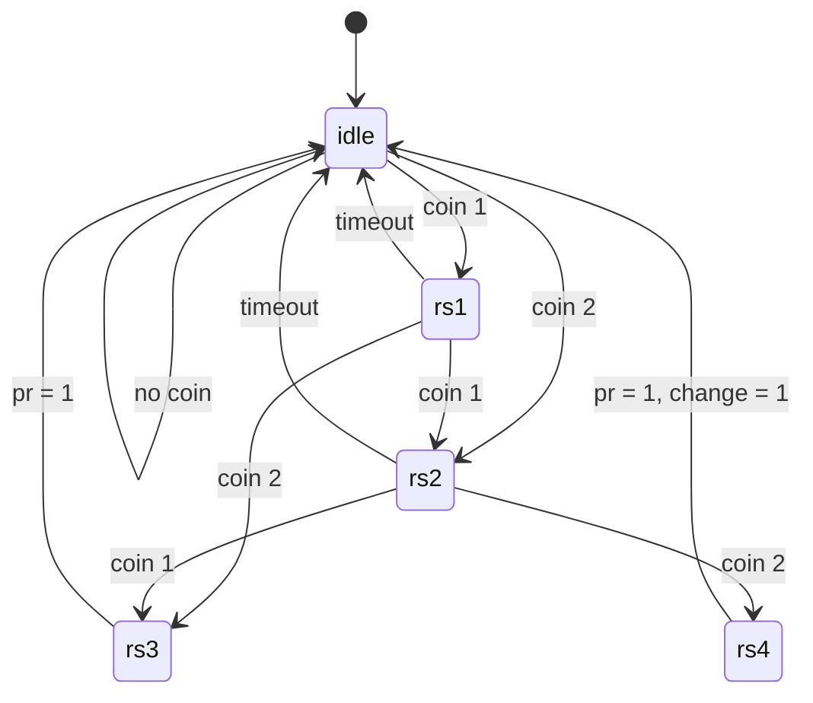

# Vending Machine Controller (Verilog FSM)

A Moore finite state machine written in Verilog that accepts coins, dispenses a product once enough money is inserted, and flags when change is due.

## Overview

| Item | Detail |
|---|---|
| Language | Verilog / SystemVerilog (`.sv` files) |
| Design style | Synchronous FSM, Moore (outputs depend only on the current state) |
| Coins accepted | 1-unit and 2-unit |
| Product price | 3 units |
| Reset | Synchronous, active-high |
| Outputs | `pr` (dispense product), `change` (return 1 unit) |

## Repository Structure

| File | Description |
|---|---|
| `design.sv` | `vending_fsm` module (the controller) |
| `testbench.sv` | Testbench for simulating the design |
| `Screenshot 2026-08-20 200924.png` | Simulation waveform screenshot |

## Interface

```verilog
module vending_fsm (
    input        clk,      // clock
    input        rst,      // synchronous reset, active high
    input  [1:0] coin,     // coin input
    output reg   pr,       // 1 = dispense product
    output reg   change    // 1 = return 1 unit of change
);
```

| `coin` | Meaning |
|---|---|
| `2'b00` | No coin |
| `2'b01` | 1-unit coin inserted |
| `2'b10` | 2-unit coin inserted |
| `2'b11` | Treated as no coin |

## How It Works

Each state represents the total amount inserted so far.

| State | Total inserted | `pr` | `change` | Behavior |
|---|---|---|---|---|
| `idle` | 0 | 0 | 0 | Waits for the first coin |
| `rs1` | 1 | 0 | 0 | Waits for more coins |
| `rs2` | 2 | 0 | 0 | Waits for more coins |
| `rs3` | 3 | 1 | 0 | Exact payment: dispense, then return to `idle` |
| `rs4` | 4 | 1 | 1 | Overpaid by 1: dispense and return change, then return to `idle` |

### State Diagram



### Example Transactions

| Coins inserted | Total | Result |
|---|---|---|
| 1 + 1 + 1 | 3 | Product dispensed |
| 1 + 2 | 3 | Product dispensed |
| 2 + 1 | 3 | Product dispensed |
| 2 + 2 | 4 | Product dispensed, 1 unit of change |
| 1 + 1 + 2 | 4 | Product dispensed, 1 unit of change |

## Simulation

The design can be simulated with any Verilog/SystemVerilog simulator.

**EDA Playground:** paste `design.sv` into the design pane and `testbench.sv` into the testbench pane, choose a simulator, and run.

**Icarus Verilog:**

```bash
iverilog -g2012 -o vending_sim design.sv testbench.sv
vvp vending_sim
```

**Vivado / ModelSim / Questa:** add `design.sv` as a design source and `testbench.sv` as a simulation source, then run behavioral simulation.

### Waveform


## Known Limitations

- The timeout counter runs freely from reset and is not cleared when a coin is inserted, so the timeout does not measure idle time from the last coin.
- On timeout the machine returns to `idle` without a refund output.
- Only one product with a fixed price of 3 units is supported.
- `change` is a 1-bit flag for a fixed 1-unit refund, not a general change calculator.
- The combinational block has no default assignment, which can infer latches during synthesis.

## Future Improvements

- Clear the timeout counter on every coin and on return to `idle`
- Add a cancel input and a refund output
- Support multiple products with different prices
- Output the change amount as a multi-bit value
- Add a self-checking testbench with pass/fail reporting
- Synthesize in Vivado or Quartus and report resource usage and timing
- Prototype on an FPGA board with debounced buttons and LEDs

## Author

[@godboleaniket21-droid](https://github.com/godboleaniket21-droid)
